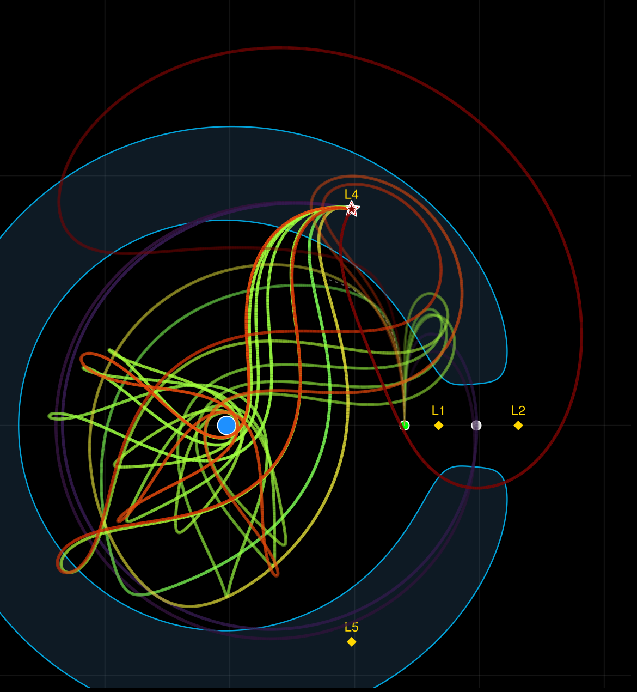

# Eleven ways to the Moon

*Draft — bead `globopt_merged-04kq.1`. Every number re-checked on 2026-10-19 against the
census artifact, the showcase page, `shooting_systems.tex` and the film descriptions
(all matched; four wordings corrected). Re-check once more on the day of publishing.*

A spacecraft sits near the Moon and has to reach L4, the stable point 60° ahead of the
Moon on its orbit, under continuous low thrust and burning as little fuel as it can. How
many genuinely different ways are there to do that?



*Every curve departs the same point at the same moment and ends exactly on L4; the shaded
region cannot be reached on the starting energy.*
*Legend: blue disc Earth, grey disc Moon, star L4; colour is flight time.*
*A label-free crop of the census still (source in `assets/README.md`); the tracked,
labelled version is `docs/showcase/assets/cr3bp_extremals.png`, generated by
`experiments/sandbox/cr3bp_extremals_figure.jl` from
`globtim_results/cluster/cr3bp_freeT_7d_zero_probe/`.*

## Eleven

The answer is eleven. Not "about eleven": each of the eleven is a solution of the full
set of optimality conditions, isolated from the others, and checked to a residual below
10⁻¹⁰ (the largest over the eleven is 8 × 10⁻¹¹). Their flight times run from 17 to
53 days, and every one of them loops around the Earth at least once before arriving.

What makes the count possible is asking the right question. Optimal control turns the
transfer into a *shooting problem*: seven unknown numbers at departure (six that encode
the control law, plus the flight time), and seven conditions at arrival that a
fuel-optimal route must satisfy exactly. A route is a solution when all seven conditions
hold, not when it merely comes close.

That distinction is the whole story of the search. A census of 4,300 local solves,
8.6 million trajectory integrations in all, ended like this:

| Where the solve ended | Starts | Distinct |
|---|---:|---:|
| on a solution — all seven conditions hold | 146 | **11** |
| at a local minimum of the miss distance that is not a solution | 2,603 | 1,224 |
| stalled or unusable | 1,551 | — |

There are a hundred routes that get *close* to L4 and look optimal for every one that
*is*. A search ranked by miss distance returns those hundred; a search that solves the
seven conditions tells them apart. Earlier figures of 36, 56 and 360 "routes" were
basin counts from miss-distance runs — places where a derivative-free search stalled,
not solutions of the seven conditions — and no run record backs them.

## What the approximate map sees

Globtim does not search by trial routes. It samples the miss distance over a box of
starting values, fits a polynomial to the samples — the *approximate map* — and finds
every critical point of that polynomial at once: every valley floor, mountain pass and
hilltop. Each critical point is then flown as a trajectory and fine-tuned on the true
miss distance. The three films below show the three steps on reduced versions of this
problem with four of the seven unknowns free: the first on a two-unknown map at a fixed
flight time of 9.6 days, the second on a 2-to-26-day slice, the third on a 13-to-52-day
box.

| Film | What it shows |
|---|---|
| [What Globtim does](../videos/highlights/globtim_highlight_1_approximate_map_public.md) | the true map of the miss distance beside Globtim's approximate map, degree 4 to 24, and the critical points of the map flown as routes |
| [Every critical point, by kind](../videos/highlights/globtim_highlight_2_critical_points_by_kind_public.md) | valley floors are few (15) but 14 of them reach L4 after fine-tuning; mountain passes are many (401) and 300 of them do |
| [Guesses, then routes](../videos/highlights/globtim_highlight_3_guesses_to_routes_public.md) | 180 raw guesses from one approximate map become 112 distinct routes, 13 to 52 days long |

## Where it breaks

Two honest limits, both measured.

**Fewer unknowns, no solutions.** The films above work on reduced versions of the
problem with four of the seven unknowns free, and the showcase page adds a five-unknown
version. On those reduced problems there is
*no* route that satisfies all the optimality conditions — the set of routes that hit L4
exactly is a curve, so there is nothing to count — and the eleven appear only once all
seven unknowns are free. The richness came from raising the dimension of the search, not
from more elaborate physics.

**On the full problem, the map is the expensive way to find them.** Thirteen Globtim
configurations on a box containing five of the eleven — polynomials of degree 3 to 5 on
up to 256 sub-boxes, 41 million integrations in total — recovered three of the five
between them, and no single configuration more than one. The local-solve census found
all eleven for a fifth of the integrations. On this objective the solutions are tiny
targets: over 4,000 random points of the box the miss is never below 0.79 and typically
139, in units where a solution has miss zero, and a polynomial fitted from a few thousand
samples does not resolve them. What the map is for
is the reduced problem, where it organises hundreds of routes into families in a single
fit.

## Reproduce

Redraw the eleven from the committed census (seconds):

```bash
julia --project=profiles/viz experiments/sandbox/cr3bp_extremals_figure.jl
```

`--selftest` re-evaluates the seven conditions at each of the eleven and fails if any no
longer vanish. The census itself is a cluster job:

```bash
julia --project=profiles/cluster --threads=auto experiments/sandbox/cr3bp_freeT_7d_zero_probe.jl --nscan 60000 --ntop 300 --nrand 100
```

## Go deeper

- [CR3BP transfers](../showcase/cr3bp_transfers.md) — the showcase page: the shooting system, the eleven, the 1,224 false minima
- [shooting_systems.tex](../shooting_systems.tex) — the 7 × 7 shooting system in full and the subdivision ensemble, configuration by configuration
- [Opt_Traj](../../pkg/Opt_Traj/README.md) — the package: Pontryagin shooting, the three-body dynamics, the landscape explorer

---

*Provenance. The eleven and the census table: `globtim_results/cluster/cr3bp_freeT_7d_zero_probe/`,
cited by artifact path and generator script (no ledger run_id; bead orxx.7.4.1), re-verified
on the showcase page by replaying every zero through the augmented flow. The ensemble
numbers: `docs/shooting_systems.tex`, Table 2 (the ensemble); the 4,000-point miss
statistics are on that table's box B and come from the tex, not from the census artifact
directory (whose own 60,000-point scan is on a different box). The film counts: the
highlight descriptions in `docs/videos/highlights/`. Flight times are converted at one
Earth–Moon time unit = 4.3425 days.*
