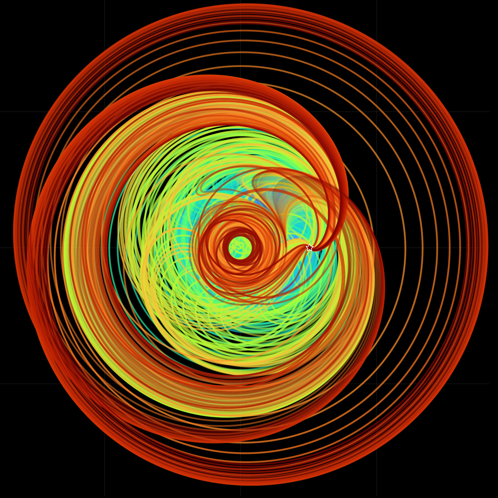

# Hundreds of routes to Mars

*Draft — bead `globopt_merged-04kq.2`. Numbers taken from the campaign records on
2026-10-19; the catalogue count is cited by artifact path (no ledger run_id yet, bead
orxx.7.4.1), every comparison number by ledger run_id. Re-check before publishing.*

Leave Earth on a given day under continuous low thrust and arrive at Mars on a given day,
burning as little as you can. How many genuinely different ways are there to do that?



*Every route departs Earth at the same moment and ends on Mars, held still on the right
because the frame turns with it; the arrival times run from four months to six years.*
*Legend: the Sun at the centre, Earth's orbit the inner circle; colour is flight time.*
*A label-free still of the catalogue film (source in `assets/README.md`).*

## Five hundred and forty-four

Fixing the departure and the arrival day turns the question into a *shooting problem*:
six unknown numbers at departure, which encode the control law, and six conditions at
arrival, Mars's position and Mars's velocity. A route is a solution when all six hold,
here to better than one part in a billion, and not when it merely passes close.

The census asked that question at 77 arrival times, from 2 to 40 time units (one unit is
58 days, so four months to six years), with 400 starting guesses at each. It found 544
distinct routes. Every arrival time has at least one; the richest, 698 days, has 22. For
scale, the textbook Hohmann transfer takes 259 days; these routes take longer and trade
flight time for shape, looping around the Sun anywhere from two times backwards to twenty
times forwards, and the cheapest of them burn a hundredth of the fuel of the costliest at
the same arrival time.

They also come in families. Slide the arrival day and a route deforms continuously into
its neighbour; the catalogue falls into 219 such families, the largest spanning arrival
times from 698 days to nearly five and a half years along a single loop around the Sun.

Five hundred and forty-four is a floor, not a count. A third of the routes were reached by
a single guess out of four hundred, and doubling the guesses raised the total to 682.
Pooling five independent searches at the 698-day arrival finds 55 routes where the
catalogue lists 22, and at 1,163 days 42 where it lists 4, with the union still growing at
the fifth search. Nobody yet knows how many routes there are.

| Film | What it shows |
|---|---|
| Earth to Mars in 698 days (film 3) | the 22 routes at one arrival time leaving together and meeting Mars on the same day; colour is fuel cost |
| Earth to Mars, 544 routes grouped by loops around the Sun (film 8) | the whole catalogue, one panel per number of loops, all turning with Mars |
| The checked routes Globtim's guesses lead to (film 9) | what the approximate map's guesses become after fine-tuning and checking, at 698 days |
| Globtim's guesses after fine-tuning (film 10) | the step before: the guesses polished, none of them quite meeting Mars |

Films 3 and 8 are the census itself and contain no Globtim; films 9 and 10 are the
Globtim pair. Public descriptions: `docs/videos/youtube_metadata.md`, sections "3 and 8"
and "9–12".

## What the approximate map sees

Globtim samples the miss over a box of the six unknowns, fits a polynomial, the
*approximate map*, piece by piece (about a hundred pieces of degree 5), and finds every
critical point of the map at once. Each critical point is a guess; a guess is then
fine-tuned on the true conditions and checked. On the Moon problem this organises hundreds
of routes into families in a single fit. On this one, it does not, and the measurement is
clean enough to say so.

At two arrival times the same search was run five times with fresh samples, and each time
the map's guesses were raced against the same number of uniformly random guesses through
the same fine-tuning:

| Arrival | Routes from Globtim's guesses (five searches) | Routes from random guesses (five searches) |
|---|---|---|
| 698 days | 26, 37, 31, 35, 36 | 31, 34, 31, 32, 35 |
| 1,163 days | 15, 13, 14, 17, 20 | 18, 15, 17, 21, 23 |

Random guesses reach at least as many routes in 17 of the 20 paired searches run on this
problem and its Saturn twin. The map's critical points are, statistically, random seeds
here. Film 10 shows why: none of the raw guesses is anywhere near Mars; they fly off on
escape trajectories, and only the fine-tuning brings them back.

One kind of guess does keep an edge. The map's *valley floors*, its local minima, are
one or two in a hundred of its critical points, but each of them leads to a route about one
time in four (64 valley floors gave 18 routes at 698 days, 52 gave 7 at 1,163 days),
against about one in a hundred for its mountain passes and for random guesses. Fine-tune
the valley floors first and you get half the routes for a few percent of the work.

## Where it breaks

**The targets are too thin for the map.** Along one direction the miss is thousands of
times stiffer than along the others, so each solution sits at the bottom of a tube about a
thousandth of the box wide. A degree-5 polynomial fitted to a few thousand samples
resolves the plateau between the tubes, not the tubes; its critical points land on the
plateau, which is why they are no better than random starting points.

**Let the arrival day float and the count drops to zero.** With the arrival time free,
the optimality conditions have no solution at all on this model: 4,300 starts, none of
them a route, for the rendezvous and for the intercept alike. The richness is a property
of the fixed-arrival problem.

## Reproduce

The paired comparison at one arrival time, smoke size (minutes, local):

```bash
julia --project=profiles/cluster --threads=auto experiments/sandbox/outer_moon_transfer/cruise_globtim_census.jl --smoke --target mars --T 12
```

The catalogue is a cluster job (34 minutes on 24 cores):

```bash
julia --project=profiles/cluster experiments/sandbox/mars_pmp_census.jl --tmin 2.0 --tmax 40.0 --tstep 0.5 --nseeds 400 --boxlam 2.0 --out DIR
```

Redraw the 698-day routes from the committed catalogue:

```bash
julia --project=profiles/viz pkg/Opt_Traj/examples/specialized/mars_rendezvous_video.jl --catalog --T 12 --still --out _generated/mars_rendezvous_video/census_T12_still.png
```

## Go deeper

- [Mars census campaign](../../experiments/sandbox/mars_globtim_census/README.md) — the map-versus-random ladder, slice by slice, and the stiff-direction diagnosis
- [Outer-planet cruise campaign](../../experiments/sandbox/outer_moon_transfer/README.md) — the five-draw replication on Mars and Saturn
- [Opt_Traj](../../pkg/Opt_Traj/README.md) — the package: the rendezvous residual, the catalogue films, the landscape explorer

---

*Provenance. The catalogue (544 routes, 22 at 698 days, 219 families, a third reached by one
guess, 682 with 800 guesses): `globtim_results/cluster/mars_pmp_census/` and
`mars_pmp_census_n800/`, cited by artifact path and generator script
(`experiments/sandbox/mars_pmp_census.jl`; no ledger run_id, bead orxx.7.4.1). The
five-search comparison: ledger run_ids `20260921T0445xx_cruise_globtim_census_mars_T12_box05_s1`
to `_s5` (korok 1031775, 1031779, 1031783, 1031796, 1031800) and the T20 arms (1031776,
1031780, 1031784, 1031797, 1031801), with the valley-floor counts in their headlines. The
pooled counts: run_id `20260920T224457_pooled_census_wave1`; the random-only 30,000-seed
checks: korok 1031823, 1031819, 1031820. Free arrival time: korok 1017359, 1017360. The
stiff-direction statement comes from the campaign README (local probe, no run_id) and is
qualitative here for that reason. Film titles and descriptions:
`docs/videos/youtube_metadata.md`. One time unit = 58.13 days; 698 days = 12 units,
1,163 days = 20 units.*
