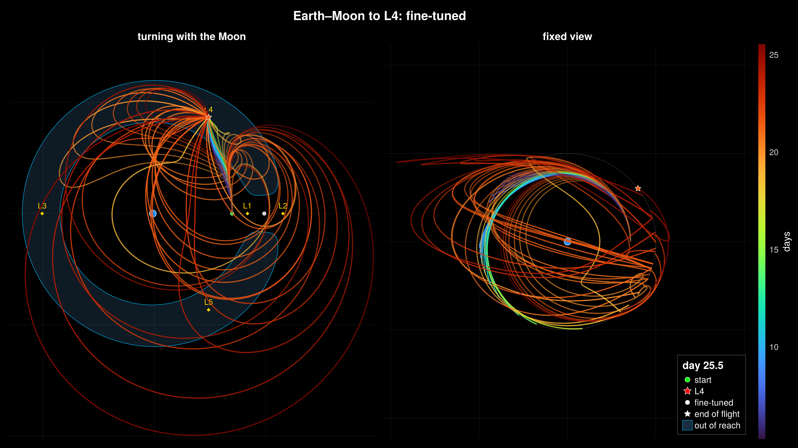
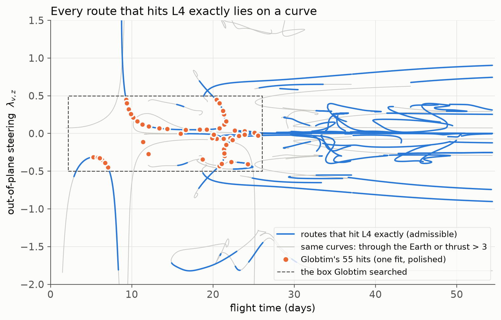

# When the solution set is a curve

*Draft — bead `globopt_merged-04kq.3`. Every number is from a ledgered run (run_ids in the
footer); the figures were rendered from those runs on 2026-10-19. Re-check before
publishing.*

A spacecraft near the Moon has to reach L4, the stable point 60° ahead of the Moon on its
orbit, under continuous low thrust. [Eleven ways to the Moon](2026-10-eleven-ways-to-the-moon.md)
counted the fuel-optimal routes: eleven. What happens to that count if you ask for less,
only that the spacecraft *arrive* at L4, and let it arrive however it likes?



*Every route leaves the same point near the Moon at the same moment and ends on L4 to
within a few hundred metres; colour is flight time, 5 to 26 days.*
*Legend: blue disc Earth, grey disc Moon, star L4, shaded region unreachable on the
starting energy. Left: the frame turning with the Moon. Right: the fixed frame.*
*The last frame of the search-stage film, rendered from the run below.*

## There is nothing to count

Asking only for the arrival position leaves four unknowns at departure, three that encode
the control law plus the flight time, against three conditions at arrival. Four unknowns,
three equations: the routes that hit L4 exactly are not isolated points but a *curve*. Take
any exact route, nudge the flight time, and a neighbouring exact route exists. "How many
routes?" has no answer on this chart; the right object is the curve itself, and the right
question is what it looks like.

A census traced it. Starting from exact hits found slice by slice at fixed flight time and
following each one as the flight time changes, two cluster jobs traced 64 curves carrying
646 exact hits over flight times from 3.5 to 52 days. Of those hits, 452 are flyable:
they stay more than 7,000 km from the centre of the Earth and never ask for more than
three units of thrust. The rest are solutions of the equations that pass through the
planet, or need engines nobody has.



*Each curve is a one-parameter family of routes that hit L4 exactly; the dashed box is
the window one approximate map searched.*
*Legend: blue the flyable parts of the curves, grey the parts through the Earth or beyond
the thrust cap, orange the map's hits.*

## What one approximate map sees

Globtim does not trace curves. It samples the miss distance over a box of the four
unknowns, splits the box into pieces, fits a polynomial to each, the *approximate map*,
and finds every critical point of the map at once: every valley floor, mountain pass and
hilltop. Each critical point is a guess; each guess is flown, fine-tuned on the true miss
distance, and checked.

One such map, 34 pieces of degree 6 over the window of flight times from 2 to 26 days,
took eight minutes on a workstation and gave:

| Stage | Count |
|---|---:|
| critical points of the map inside the box | 705 |
| of which valley floors | 36 |
| guesses that fine-tuned to a distinct endpoint | 72 |
| exact hits, miss below one part in a million of the Earth–Moon distance | **55** |

The 55 hits span flight times from 5 to 26 days and fall on both branches of the curve
set, 31 on the fast family that steers below the Moon's orbital plane and 24 on the slow
family above it. Laid over the census, 53 of the 55 sit on curves it had traced: the
typical distance from a hit to the nearest traced point is one hundredth of the box width,
closer than the census's own sampling step. One fit of the map had found, in eight
minutes, the shape the census traced over two cluster jobs.

The other two hits are the honest part. Both are exact solutions of the equations, checked
by an independent integrator to within 10⁻⁷ of the Earth–Moon distance, and both pass
4,800 and 5,400 km from the centre of the Earth, which is inside it, at thirty times the
thrust cap. The census had skipped those curves on purpose; the map does not know about
the Earth and found them anyway. A stand-in check on an earlier run had suggested the map
finds *flyable* curves the census missed; on this clean, recorded run it does not. Every
flyable hit was already on a known curve.

## Where it breaks

**It is not cheaper per hit.** At a fixed flight time, where the exact hits are isolated
points, the map's guesses and the same number of random guesses were raced through the
same fine-tuning on five slices. They reach the same hits for the same number of
trajectory integrations: 2 against 2, 4 against 4, 4 against 4, 16 against 16, and 12
against 15. What the map buys on this chart is organisation, the whole curve set from one
fit, not a lower price per route.

**The eleven live one dimension up.** Add the three remaining arrival conditions, so that
the route must arrive with the right control as well as at the right place, and the curves
collapse to the eleven isolated points of the previous post. Richness here came from
removing conditions, not from adding physics.

**The map needs to be told what is flyable.** Two of its 55 hits go through the Earth.
On any chart with a physical exclusion zone, the admissibility filter is part of the
method, not an afterthought.

| Film | What it shows |
|---|---|
| Earth–Moon routes to L4, 2–26 days: raw guesses | the 633 guesses before fine-tuning, each flown, marked by kind on the map; most are not routes to L4 at all |
| Earth–Moon routes to L4, 2–26 days: after fine-tuning | 50 routes after fine-tuning, grouped by how many times they loop around the Earth |

Public descriptions: `docs/videos/youtube_metadata.md`, section "13–26".

## Reproduce

The map, its hits and the ledger record (eight minutes on 24 threads):

```bash
julia --project=profiles/viz --threads=auto pkg/Opt_Traj/examples/specialized/cr3bp_transfer_showcase.jl --export RUN/export.jsonl --dim 4 --subdiv --box 0.5 --tcenter 3.25 --ht 2.75 --degree 6 --sampling christoffel --maxleaves 64 --maxdepth 6 --seed 42
```

```bash
julia --project=profiles/viz experiments/sandbox/post3_hit_curve/ledger_export.jl RUN
```

The second figure, from the committed census runs and the hits (seconds, no ODE):

```bash
python3 -I experiments/sandbox/post3_hit_curve/curve_figure.py --hits RUN/hits.jsonl --out hit_curves.png
```

## Go deeper

- [Runbook](../../experiments/sandbox/post3_hit_curve/README.md) — every step of this post's run, in order, with the claim-by-claim source table
- [CR3BP transfers](../showcase/cr3bp_transfers.md) — the showcase page: the shooting system, why four and five unknowns give no isolated solutions
- [Opt_Traj](../../pkg/Opt_Traj/README.md) — the package: Pontryagin shooting, the three-body dynamics, the landscape explorer

---

*Provenance. The map run: ledger run_id `20261019T194131_post3_hit_curve_globtim_4d`
(`globtim_results/local/post3_hit_curve/20261019T193232/`: 34 leaves, relative fit error
0.11, 705 raw in-box critical points, 72 basins, 55 hits with miss below 10⁻⁶ DU, largest
2.3×10⁻⁷; every hit re-flown through the preset to the same miss). The seed trace:
run_id `20261019T194250_cr3bp_branch_search_loop` (55 of 55 corrected to exact hits, 53 on
a known curve, 2 skipped as through-Earth at 4,776 and 5,397 km from the Earth's centre
with peak thrust 103 and 88). The census curves: run_ids
`20260930T051908_cr3bp_branch_search_loop_job1044005` and
`20260930T113715_cr3bp_branch_search_loop_job1044485` (646 hits on 64 merged curves, 452
admissible). The fixed-time parity: run_ids `20260929T0546..0922_cr3bp_branch_search_job1043756`
to `_job1043760` (hits per thousand integrations, map versus random: 0.040 / 0.039,
0.012 / 0.012, 0.013 / 0.012, 0.016 / 0.016, 0.041 / 0.050). The independent re-integration
of the two off-curve hits: `experiments/sandbox/post3_hit_curve/check_hits_python.py`
(4.5×10⁻⁸ and 8.1×10⁻⁸ DU). One Earth–Moon distance (DU) = 384,400 km; one time unit =
4.3425 days; the flyability thresholds are the census's (closest approach > 7,000 km, peak
thrust ≤ 3).*
